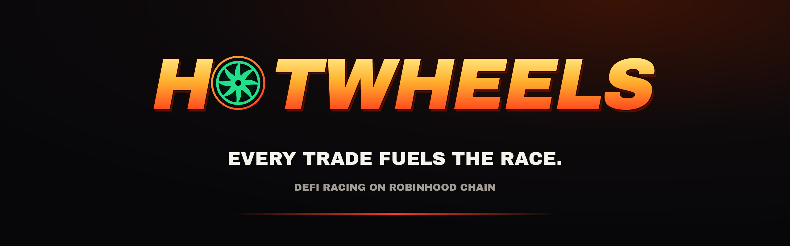
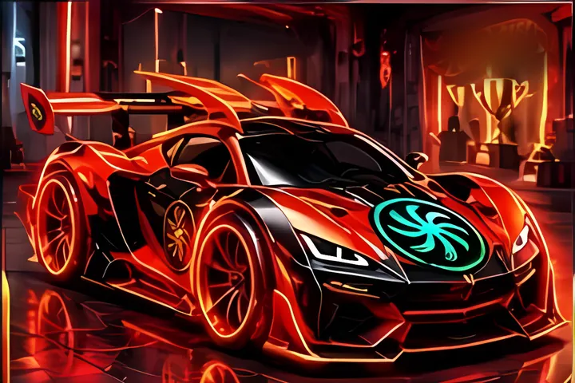

  

  
  
  

## Collect. Trade. Race.

**HOTWHEELS** is a racing ecosystem on Robinhood Chain. Collect Genesis racing cars with on-chain stats, trade on
Uniswap from one place, and line up for races where those stats decide who wins.

| | |
|---|---|
| 🏁 **Genesis Garage** | 20 racing cars, each with a rarity and five performance stats stored on-chain. Mint is live. |
| 🔁 **Trading hub** | Swap ETH, stablecoins, crypto and tokenized stocks on Robinhood Chain through Uniswap V3, routed for the best price. |
| 🔥 **HOTW token** | Launching on [flywheel.cash](https://flywheel.cash/v2): every trade feeds ETH rewards, buy & burn and locked liquidity. |
| 🏆 **Race Arena** | Coming next: free races decided by car stats and randomness no single party controls. |

## The Genesis collection

  
  
  
  

The four Legendary cars: Golden Velocity · Inferno X · Royal Drift · Ultimate Race

| Rarity | Cars | Stat budget | Supply per car | Mint price |
|---|---|---|---|---|
| Common | 3 | 300 | 500 | 0.005 ETH |
| Rare | 7 | 340 | 200 | 0.01 ETH |
| Epic | 6 | 375 | 80 | 0.025 ETH |
| Legendary | 4 | 410 | 20 | 0.05 ETH |

Every car in a tier has the same stat total but a different shape (sprinter, technician, tank, launcher…), so the
track decides which car is favoured. 3,460 cars in total, up to 5 per wallet.

- **Contract:** [`0xb6E9008805b4c80Ef32bdddbd1a1760De37C1CeB`](https://robinhoodchain.blockscout.com/address/0xb6E9008805b4c80Ef32bdddbd1a1760De37C1CeB) — source verified on Sourcify
- **Metadata & art:** pinned on IPFS
- **Mint:** [hoodwheels.fun/garage](https://www.hoodwheels.fun/garage)

## Where the trading fee goes

Once HOTW launches on flywheel.cash, every swap pays a 4% fee:

| Share | Goes to |
|---|---|
| 2.95% | Trading rewards, paid in ETH |
| 0.05% | Buy & burn |
| 0.05% | Locked liquidity |
| 0.95% | Launchpad |

Until launch there is no official HOTW contract. The address will only be announced on
[hoodwheels.fun/token](https://www.hoodwheels.fun/token) and our official channels; ignore any other token using the name.

## Built with

Solidity · Foundry · OpenZeppelin · Uniswap V3 · Next.js · wagmi · viem · IPFS

<!-- Add your social links here once the accounts exist, e.g.
## Community
[X](https://x.com/...) · [Telegram](https://t.me/...) · [Discord](https://discord.gg/...)
-->

---

Nothing here is investment advice. NFTs and tokens are experimental and can lose all value; no returns are
promised. Tokenized stocks are issued by third parties and may be restricted where you live.
